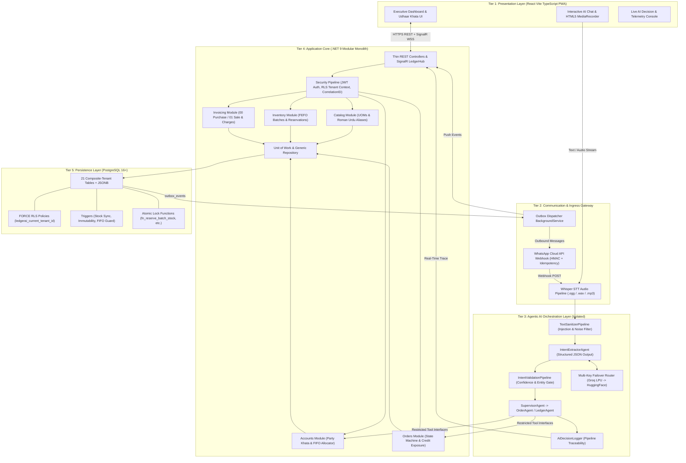
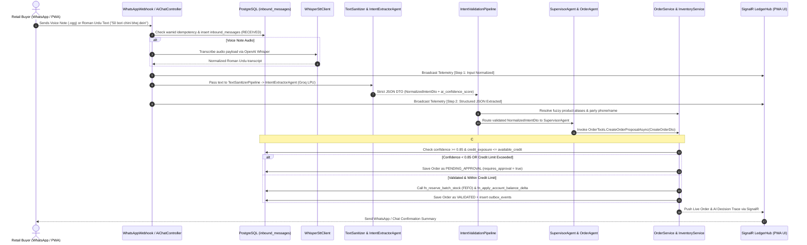
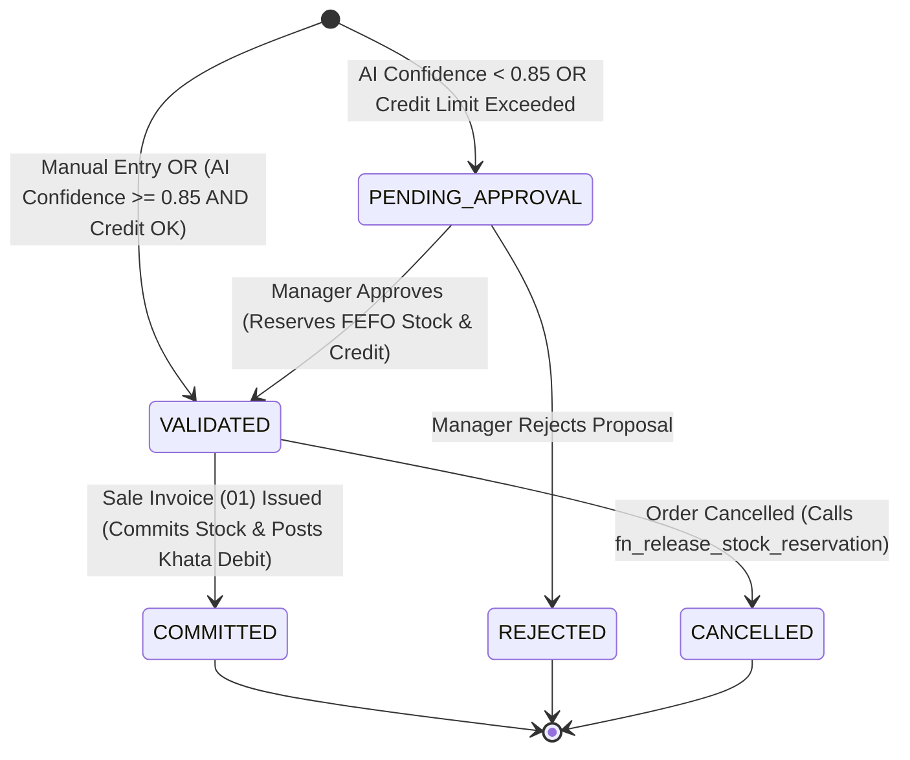
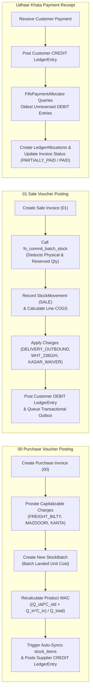
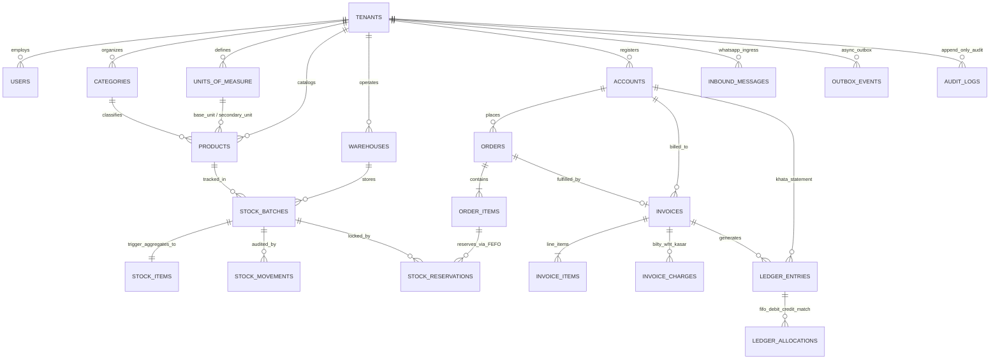
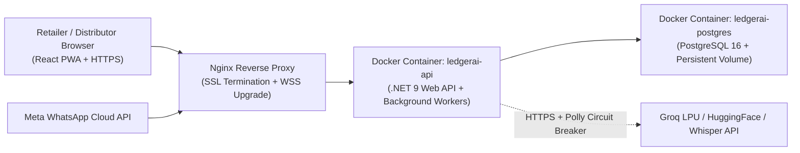

# LedgerAI — Complete System Design & Architecture Specification

**Project Title:** LedgerAI: An Event-Driven B2B Multi-Tenant ERP and Wholesale Credit Ledger with Integrated AI Agentic Workflows  
**Version:** 2.1 (Production Baseline — Aligned with `C:\projects\LedgerAi\`)  
**Target Runtime:** `.NET 9 Web API` (`C# 13`), `EF Core 9`, `PostgreSQL 16+`, `Microsoft Semantic Kernel`, `SignalR`, `React 18+ PWA`  
**Team:** Haider Ali (`23014198-097`), Ibtisam Kashif (`23014198-083`), Fazina Mukhtar (`23014198-088`)  
**Supervisor:** Prof. Muhammad Tauqeer ul Amin (Department of Software Engineering, University of Gujrat)

---

## 1. Executive Architectural Overview

**LedgerAI** is engineered as a **Five-Tier Distributed System** anchored by a **Single-Project Modular Monolith** (`.NET 9 Web API`). It modernizes Pakistani B2B wholesale distribution by combining deterministic inventory and *Udhaar Khata* (credit ledger) accounting with constraint-driven AI workflows capable of parsing Roman Urdu and English text or voice messages into structured, human-verifiable orders.

### 1.1 Core Architectural Principles
1. **AI-Independent ERP Core (Zero Single Point of Failure):** Every manual business operation (Catalog, Multi-Warehouse Stock, Party *Udhaar Khata*, Order Lifecycle, `00` Purchase & `01` Sale Invoicing, FIFO Payment Allocation) runs 100% deterministically through standard REST controllers. If Groq, HuggingFace, or OpenAI Whisper experiences downtime or rate-limit throttling, warehouse and billing operations continue uninterrupted.
2. **Strict Tool-Calling Airgap:** AI Agents (`Semantic Kernel`) have **zero** dependency on `LedgerDbContext` or raw SQL. They interact exclusively through typed C# tool wrappers (`src/AI/Tools/`) that invoke domain services (`src/Modules/*/Services`), ensuring all credit limits, stock reservations, and decimal rounding rules are enforced by deterministic C# and PostgreSQL locks.
3. **Database-Enforced Multi-Tenancy & Concurrency:** Data isolation is guaranteed at the PostgreSQL engine level via `FORCE ROW LEVEL SECURITY` (`SET LOCAL app.current_tenant`), while high-velocity inventory and balance mutations are serialized via PostgreSQL advisory/row-level lock functions (`fn_reserve_batch_stock`, `fn_apply_account_balance_delta`).
4. **Full AI Pipeline Observability:** Every step of an AI request (`Sanitization` $\rightarrow$ `Whisper STT` $\rightarrow$ `JSON Intent Extraction` $\rightarrow$ `Validation Gate` $\rightarrow$ `Agent Tool Execution`) is recorded by `src/AI/Monitoring/` and broadcast live over SignalR (`LedgerHub`) to the React PWA dashboard.

---

## 2. High-Level System Architecture (Five-Tier + Modular Monolith)



---

## 3. Software Design Patterns Applied

| Design Pattern | Where Implemented | Architectural Purpose & Benefit |
| :--- | :--- | :--- |
| **Modular Monolith (Domain-Modular)** | `src/Modules/{Catalog, Inventory, Accounts, Orders, Invoicing}` | Groups domain entities, services, and calculators by bounded business context inside a single `.NET 9` deployable, eliminating microservice network latency while preserving clean module boundaries. |
| **Repository & Unit of Work (UoW)** | `src/Data/Repositories/` & `src/Data/UnitOfWork/` | Abstracts EF Core `DbContext` queries and wraps multi-table operations (e.g., `Sale Invoice` + `Batch Deduction` + `Ledger Debit` + `Outbox Event`) inside a single ACID transaction. |
| **Transactional Outbox Pattern** | `outbox_events` table + `src/Communication/Workers/OutboxDispatcherWorker.cs` | Guarantees reliable delivery of SignalR broadcasts and WhatsApp confirmations without risking distributed two-phase commit failures or rolling back completed financial transactions. |
| **EF Core Interceptor Pattern** | `src/Data/Interceptors/TenantRlsInterceptor.cs` | Automatically injects `SET LOCAL app.current_tenant = '{tenantId}';` immediately upon opening a PostgreSQL connection/transaction so RLS policies apply transparently to every query. |
| **Chain of Responsibility (Pipeline)** | `src/AI/Pipelines/` (`TextSanitizer` $\rightarrow$ `IntentExtractor` $\rightarrow$ `IntentValidation`) | Processes messy conversational inputs through discrete, testable stages—cleaning security risks, enforcing JSON schema output, and gating low-confidence proposals before any agent acts. |
| **Supervisor / Tool-Calling Agent Pattern** | `src/AI/Agents/SupervisorAgent.cs` & `src/AI/Tools/` | Decouples natural language reasoning from deterministic business execution. Agents only invoke annotated `[KernelFunction]` C# tools backed by domain services. |
| **Circuit Breaker & Failover Strategy** | `src/AI/Routers/LlmFailoverRouter.cs` (via **Polly v8**) | Automatically rotates Groq API keys on HTTP `429` rate limits and fails over to HuggingFace Inference endpoints on `5xx` timeouts. |
| **Idempotency Key Pattern** | `inbound_messages (wamid)`, `orders`, `invoices`, `ledger_entries` | Prevents duplicate order creation, double stock deduction, or duplicate ledger postings when Meta WhatsApp or mobile clients retry timed-out HTTP requests. |

---

## 4. Exact Project & Folder Structure (`C:\projects\LedgerAi\`)

This structure matches your exact workspace setup: `LedgerAi/` at the root containing `Docs/` (with `Schemas/`, `Diagrams/`, `PDFs/`, and Markdown docs) and `LedgerAI.Api/` (your ASP.NET Core `.NET 9` Web API project) with `src/` nested cleanly inside it:

```text
LedgerAi/                                       # Root Repository Directory (C:\projects\LedgerAi)
├── Docs/                                       # 📁 Project Documentation, Schemas, Diagrams & PDFs
│   ├── Schemas/                                # Database DDL & SQL migration scripts
│   │   └── LedgerAI_Schema_v2.sql              # Master PostgreSQL 16+ DDL (21 tables, RLS, triggers, functions)
│   ├── Diagrams/                               # Architecture, Component, Sequence & EERD diagrams
│   │   ├── system-architecture.png
│   │   ├── component-diagram.jpg
│   │   └── database-eerd.png
│   ├── PDFs/                                   # Proposal, Calculation Specs & FYP Reports
│   │   ├── PROPOSL_final_ledgerai.pdf
│   │   ├── Mathematics_Calculations_and_Categories.pdf
│   │   └── FYP_Progress_Report.docx
│   ├── LedgerAI_Master_SRS_and_Backend_Blueprint.md
│   └── LedgerAI_System_Design_Document.md
│
├── .gitignore                                  # Standard .NET / Visual Studio / OS gitignore
├── LICENSE                                     # MIT License
├── README.md                                   # Project quick-start guide
│
└── LedgerAI.Api/                               # [Single .NET 9 ASP.NET Core Web API Project Root]
    ├── LedgerAI.Api.csproj                     # .NET 9 project file & NuGet package references
    ├── LedgerAI.Api.sln                        # Visual Studio 2022 Solution file
    ├── Dockerfile                              # Production multi-stage Docker build
    ├── docker-compose.yml                      # Local PostgreSQL 16 + pgAdmin / Redis stack
    ├── Program.cs                              # Host configuration, DI container wiring & middleware pipeline
    ├── appsettings.json                        # Default configuration settings (DB strings, JWT, Groq keys)
    ├── appsettings.Development.json            # Local environment overrides
    ├── Properties/
    │   └── launchSettings.json                 # Local Kestrel / IIS profiles (ports 7274 / 5284)
    │
    └── src/                                    # 📁 Application Source Code (Inside LedgerAI.Api)
        ├── Core/                               # [Cross-Cutting Concerns & Shared Global Primitives]
        │   ├── Common/                         # BaseEntity, Result<T>, PagedResult<T>, DomainExceptions
        │   ├── Interfaces/                     # IRepository<T>, IUnitOfWork, ITenantContext, ICurrentUser
        │   ├── Security/                       # JwtSettings, TenantContext, RolePolicies, PasswordHasher
        │   └── Enums/                          # OrderStatus, InvoiceType, AccountType, RiskTier, ChargeTreatment
        │
        ├── Data/                               # [Persistence Layer & Strict DTO Separation]
        │   ├── Context/                        # LedgerDbContext.cs (EF Core 9 Fluent API mappings & views)
        │   ├── Repositories/                   # Generic Repository<T> implementation
        │   ├── UnitOfWork/                     # UnitOfWork.cs (ACID transaction & atomic SQL function executors)
        │   ├── Interceptors/                   # TenantRlsInterceptor.cs (SET LOCAL app.current_tenant)
        │   ├── Migrations/                     # EF Core PostgreSQL migrations
        │   ├── Seeders/                        # DemoTenantSeeder.cs (Products, UOMs, Warehouses, Parties)
        │   └── Dtos/                           # Strict Data Transfer Objects (Decoupled from Entity models)
        │       ├── Auth/                       # LoginRequestDto, AuthResponseDto
        │       ├── Catalog/                    # ProductDto, CreateProductDto, UnitOfMeasureDto
        │       ├── Inventory/                  # StockBatchDto, StockSummaryDto, BatchAllocationDto
        │       ├── Accounts/                   # AccountDto, LedgerStatementDto, RecordPaymentDto
        │       ├── Orders/                     # CreateOrderDto, OrderResponseDto, ApproveOrderDto
        │       ├── Invoicing/                  # CreateInvoiceDto, InvoiceResponseDto, InvoiceChargeDto
        │       └── AI/                         # NormalizedIntentDto, AiTelemetryEventDto, ChatRequestDto
        │
        ├── Modules/                            # [Domain Feature Modules — 100% AI-Independent]
        │   ├── Catalog/
        │   │   ├── Entities/                   # Category.cs, UnitOfMeasure.cs, Product.cs
        │   │   ├── Services/                   # ICatalogService.cs, CatalogService.cs, UnitConversionCalculator.cs
        │   │   └── Validators/                 # CreateProductValidator.cs
        │   ├── Inventory/
        │   │   ├── Entities/                   # Warehouse.cs, StockItem.cs, StockBatch.cs, StockMovement.cs, StockReservation.cs
        │   │   ├── Services/                   # IInventoryService.cs, InventoryService.cs, FefoBatchPicker.cs
        │   │   └── Validators/                 # StockAdjustmentValidator.cs
        │   ├── Accounts/
        │   │   ├── Entities/                   # Account.cs, LedgerEntry.cs, LedgerAllocation.cs
        │   │   ├── Services/                   # IAccountService.cs, ILedgerService.cs, FifoPaymentAllocator.cs, CreditRiskService.cs
        │   │   └── Validators/                 # RecordPaymentValidator.cs
        │   ├── Orders/
        │   │   ├── Entities/                   # Order.cs, OrderItem.cs
        │   │   ├── Services/                   # IOrderService.cs, OrderService.cs, OrderCalculationService.cs
        │   │   └── Validators/                 # CreateOrderValidator.cs
        │   ├── Invoicing/
        │   │   ├── Entities/                   # Invoice.cs, InvoiceItem.cs, InvoiceCharge.cs
        │   │   ├── Services/                   # IInvoiceService.cs, InvoiceService.cs, InvoiceCalculationService.cs, WacCalculator.cs
        │   │   └── Validators/                 # CreateInvoiceValidator.cs
        │   └── Operations/
        │       └── Entities/                   # Tenant.cs, User.cs, InboundMessage.cs, OutboxEvent.cs, AuditLog.cs
        │
        ├── AI/                                 # [Multi-Agent AI Orchestration, Pipelines & Telemetry]
        │   ├── Agents/                         # IntentExtractorAgent.cs, SupervisorAgent.cs, OrderAgent.cs, LedgerAgent.cs
        │   ├── Tools/                          # OrderTools.cs, CatalogTools.cs, LedgerTools.cs (Safe C# wrappers)
        │   ├── Pipelines/                      # TextSanitizerPipeline.cs, IntentValidationPipeline.cs
        │   ├── Prompts/                        # IntentExtractionPrompt.txt, OrderAgentPrompt.txt
        │   ├── Routers/                        # LlmFailoverRouter.cs (Groq multi-key + HuggingFace fallback)
        │   ├── Monitoring/                     # IAiDecisionLogger.cs, AiDecisionLogger.cs (Live SignalR trace broadcaster)
        │   └── AiOrchestrator.cs               # Main entry point coordinating pipelines, agents & telemetry
        │
        ├── Communication/                      # [External Channels & Background Workers]
        │   ├── WhatsApp/                       # WhatsAppCloudClient.cs, HmacSignatureValidator.cs, WhisperSttClient.cs
        │   └── Workers/                        # OutboxDispatcherWorker.cs (BackgroundService polling outbox_events)
        │
        └── Api/                                # [Presentation Layer — Thin Controllers, Webhooks & Hubs]
            ├── Middlewares/                    # GlobalExceptionMiddleware.cs, CorrelationIdMiddleware.cs, TenantResolutionMiddleware.cs
            ├── Controllers/                    # AuthController, CatalogController, InventoryController, AccountsController, OrdersController, InvoicesController, LedgerController, AiChatController
            ├── Webhooks/                       # WhatsAppWebhookController.cs
            └── Hubs/                           # LedgerHub.cs (SignalR WebSocket hub for ERP & AI telemetry)
```

---

## 5. End-to-End System Workflows & Sequence Diagrams

### 5.1 AI Order Ingestion Pipeline (WhatsApp / Chatbot $\rightarrow$ Structured JSON $\rightarrow$ Human-in-the-Loop)



### 5.2 Order Lifecycle State Machine



### 5.3 Purchase (`00`) & Sale (`01`) Invoicing + FIFO Khata Settlement Flow



---

## 6. Database Design (EERD & PostgreSQL 16+ Engine Features)

Your database (`Docs/Schemas/LedgerAI_Schema_v2.sql`) consists of **21 hardened relational tables** organized across 5 domains, using composite `(tenant_id, id)` foreign keys across every relationship to prevent cross-tenant linking bugs.

### 6.1 Entity-Relationship Diagram (EERD)



### 6.2 Advanced PostgreSQL Engine Features (Beyond Tables)

| Database Mechanism | Exact Object Names | Role in Production Architecture |
| :--- | :--- | :--- |
| **Row-Level Security (`FORCE RLS`)** | `ledgerai_current_tenant_id()`, `ledgerai_assert_tenant()`, `tenant_isolation_*` (21 policies) | Enforces multi-tenant isolation inside PostgreSQL itself using session variable `app.current_tenant`. Even a buggy LINQ query cannot leak cross-tenant records. |
| **Trigger-Maintained Aggregate Inventory** | `trg_guard_stock_items_direct_write`, `trg_sync_stock_items_from_batches`, `ledgerai_recalc_stock_item()` | Blocks direct SQL writes to `stock_items` (`pg_trigger_depth() < 2`) and uses `pg_advisory_xact_lock` to recalculate warehouse stock totals whenever `stock_batches` change. |
| **Atomic Concurrency Lock Helpers** | `fn_reserve_batch_stock()`, `fn_release_stock_reservation()`, `fn_commit_batch_stock()`, `fn_apply_account_balance_delta()` | Executes row-level `FOR UPDATE` locking and atomic quantity/credit math inside PostgreSQL so concurrent orders never oversell stock or breach credit limits. |
| **FIFO Ledger Allocation Guard** | `trg_validate_ledger_allocation` (`ledgerai_validate_allocation()`) | Locks both `DEBIT` and `CREDIT` ledger rows via `FOR UPDATE` and prevents over-allocating payments beyond remaining open invoice/entry balances. |
| **Immutable Audit Protection** | `trg_audit_logs_immutable` (`ledgerai_prevent_audit_mutation()`) | Blocks all `UPDATE` and `DELETE` statements on `audit_logs` at the database trigger level (`ERRCODE 42501`). |
| **Generated Stored Columns** | `voucher_series` (`00`/`01`), `balance_due`, `total_price`, `total_cost`, `line_total`, `line_cogs` | Offloads deterministic row-level totals and voucher series prefixes (`00` Purchase vs `01` Sale) directly to PostgreSQL generated columns. |
| **Security-Invoker Reporting Views** | `v_product_stock_totals`, `v_invoice_profit_summary` | Computes real-time available stock and true net gross profit (factoring in COGS, outbound delivery expenses, and *Kasar* waivers) while respecting caller RLS policies. |
| **GIN JSONB & FEFO Composite Indexes** | `idx_stock_batches_fefo`, `idx_products_attributes_gin`, `idx_uom_aliases_gin`, `idx_outbox_ready` | Accelerates FEFO expiry sorting (`expires_at ASC NULLS LAST`), Roman Urdu alias lookups inside JSONB arrays, and partial-index outbox polling. |

---

## 7. Domain Mathematical & Accounting Engine Rules

All financial and inventory calculations in C# execute using `decimal` rounded to **4 decimal places** (`MidpointRounding.AwayFromZero`) to match `NUMERIC(18,4)`:

1. **Two-Tier Unit Conversion:**
   $$\text{base\_quantity} = \text{round}(\text{ordered\_quantity} \times \text{conversion\_factor}, 4)$$
2. **Purchase Landed Cost Proration & Weighted Average Cost (WAC):**
   $$\text{allocated\_charge}_i = \text{round}\left(L_{\text{total}} \times \frac{\text{line\_total}_i - \text{tax\_amount}_i}{V_{\text{total}}}, 4\right)$$
   $$\text{WAC}_{\text{new}} = \text{round}\left(\frac{(Q_{\text{old}} \times C_{\text{old}}) + \sum (\text{base\_quantity}_{\text{in}} \times \text{batch\_unit\_cost}_i)}{\max(Q_{\text{old}} + \sum \text{base\_quantity}_{\text{in}}, 1)}, 4\right)$$
3. **Invoice Grand Total with Localized Wholesale Charges:**
   $$\text{grand\_total} = \text{round}((\text{subtotal\_amount} - \text{discount\_amount} + \text{tax\_amount}) + C_{\text{ADD\_TO\_BILL}} - C_{\text{DEDUCT\_FROM\_BILL}}, 4)$$
4. **Udhaar Khata Sign Convention & Credit Risk Tiers:**
   * `current_balance > 0 (DR)`: Customer owes business (Receivable) or Supplier advance.
   * `current_balance < 0 (CR)`: Business owes Supplier (Payable) or Customer advance credit.
   * **CRITICAL Risk Tier:** `90+ days overdue > 0` OR `Credit Utilization >= 1.00`.

---

## 8. Complete Package & Dependency Manifest

### 8.1 Backend Packages (`LedgerAI.Api.csproj` — `.NET 9`)

| Category | NuGet Package | Version | Purpose |
| :--- | :--- | :--- | :--- |
| **Database & ORM** | `Npgsql.EntityFrameworkCore.PostgreSQL` | `9.0.x` | PostgreSQL 16+ provider with native `JSONB`, `UUID`, and `xmin` concurrency mapping. |
| **EF Core Tooling** | `Microsoft.EntityFrameworkCore.Design` | `9.0.x` | CLI/PMC migration generation (`dotnet ef migrations add`). |
| **API Documentation** | `Swashbuckle.AspNetCore` *(or `Scalar.AspNetCore`)* | `6.8.1` / `1.2.63` | Interactive OpenAPI/Swagger testing interface on `.NET 9`. |
| **Authentication** | `Microsoft.AspNetCore.Authentication.JwtBearer` | `9.0.x` | Stateless JWT Bearer validation and role-based policy enforcement. |
| **Validation** | `FluentValidation.AspNetCore` | `11.3.x` | Declarative validation for DTOs, fractional UOM checks, and AI extracted intents. |
| **AI Orchestration** | `Microsoft.SemanticKernel` | `1.30+` | Multi-agent orchestration, prompt templates, and typed C# `[KernelFunction]` tool-calling. |
| **AI Connectors** | `Microsoft.SemanticKernel.Connectors.OpenAI` | `1.30+` | OpenAI-compatible client used to connect to **Groq LPU** (`api.groq.com/openai/v1`), **HuggingFace**, and **Whisper STT**. |
| **Resilience** | `Microsoft.Extensions.Http.Resilience` (`Polly v8`) | `9.0.x` | Circuit breakers, exponential backoff retries, and multi-key failover for LLM/WhatsApp HTTP calls. |
| **Structured Logging** | `Serilog.AspNetCore` + `Serilog.Sinks.Console` | `8.0.x` | Structured JSON logging enriched with `CorrelationId` and `TenantId`. |
| **Real-Time** | `Microsoft.AspNetCore.SignalR` *(Built-in `.NET 9`)* | `9.0` | Bi-directional WebSocket hub (`LedgerHub`) for live dashboard updates and AI pipeline telemetry. |

### 8.2 Frontend Packages (`React 18+ PWA` — Fazina Mukhtar)

| Package | Purpose |
| :--- | :--- |
| `react`, `react-dom`, `typescript`, `vite` | Fast SPA/PWA build toolchain with strict TypeScript DTO contracts. |
| `vite-plugin-pwa` | Service worker generation and manifest configuration for installable mobile/desktop PWA. |
| `tailwindcss`, `lucide-react` | Responsive utility-first styling and clean ERP iconography. |
| `@microsoft/signalr` | Real-time WebSocket client subscribing to `LedgerHub` for live stock, Khata, and AI trace events. |
| `@tanstack/react-query`, `axios` | Server-state caching, optimistic UI updates, and JWT interceptor handling. |

---

## 9. Deployment & Infrastructure Architecture



* **Local Development:** Orchestrated via `docker-compose.yml` running `postgres:16-alpine` (initialized automatically with `Docs/Schemas/LedgerAI_Schema_v2.sql`) alongside Visual Studio 2022 Kestrel (`https://localhost:7274`).
* **Production VPS:** Multi-stage `Dockerfile` building a trimmed `.NET 9` runtime image behind Nginx with SSL/TLS and WebSocket support enabled for SignalR.