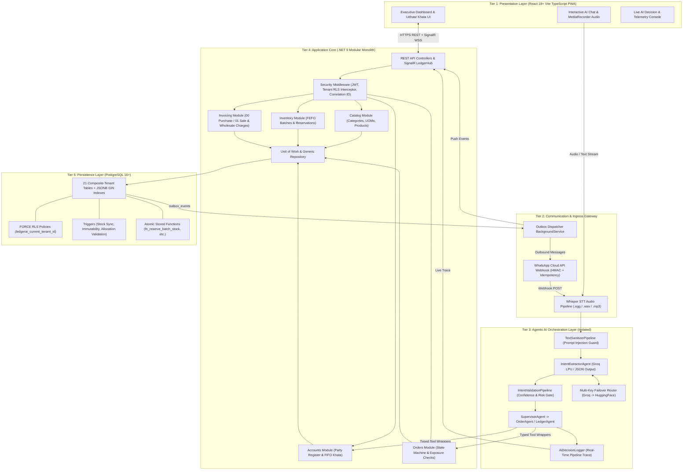
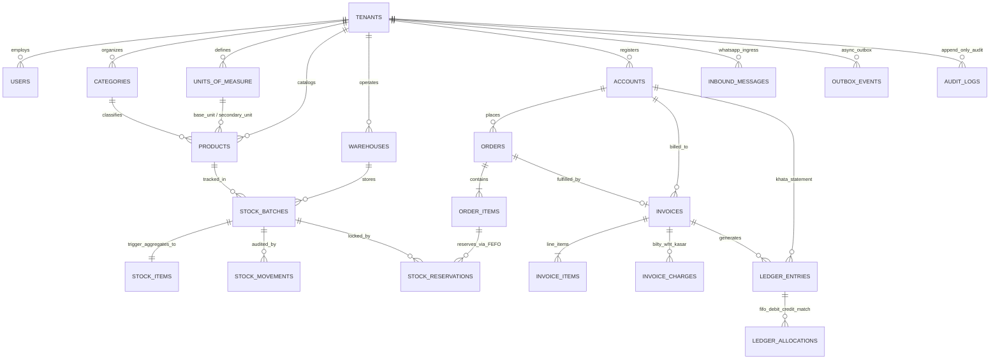
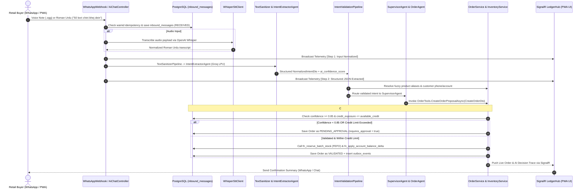
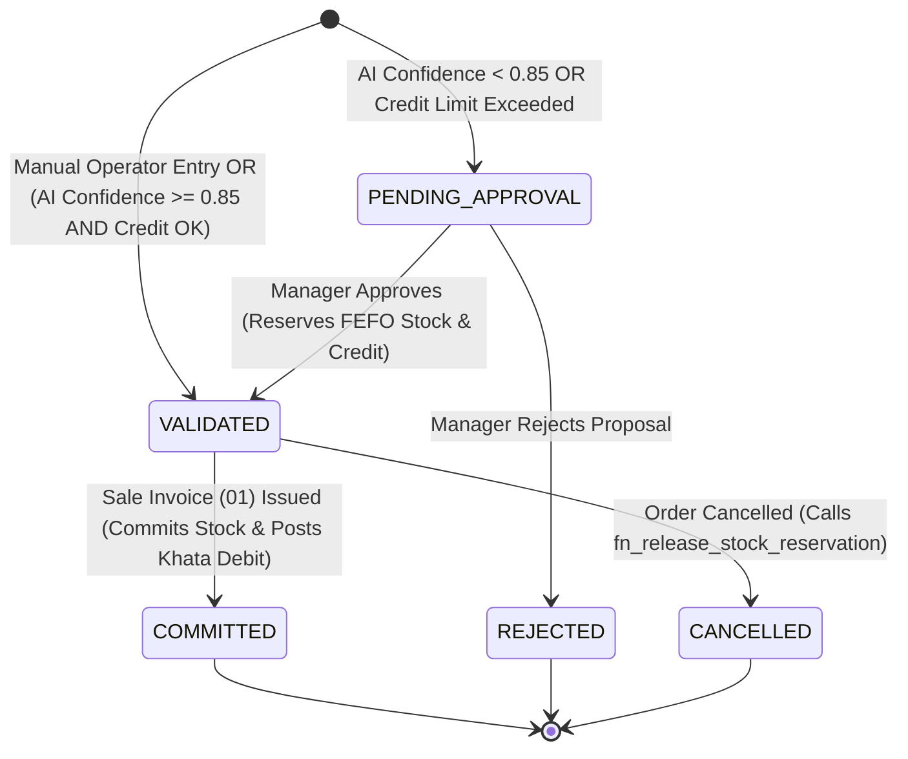
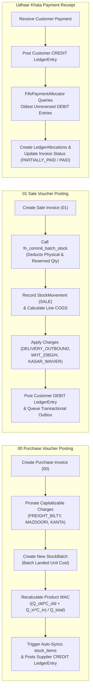

# LedgerAI: Enterprise B2B Multi-Tenant ERP, Inventory & Wholesale Credit Ledger with Integrated Agentic AI

[](https://dotnet.microsoft.com/)
[](https://www.postgresql.org/)
[](https://learn.microsoft.com/en-us/ef/core/)
[](https://scalar.com/)
[](LICENSE)

> **Document ID:** `LEDGERAI-ROOT-BLUEPRINT-2026-V2.2`  
> **Repository Scope:** Monolith Root Repository (Documentation, Database Architecture, Backend Engine & PWA Contracts)  
> **Academic Baseline:** Final Year Project (FYP) — Department of Software Engineering, Faculty of Computing & Information Technology, University of Gujrat, Punjab, Pakistan  
> **Standard Compliance:** IEEE Std 830-1998 / ISO/IEC/IEEE 29148:2018  
> **Project Team:**  
> * **Haider Ali** (`23014198-097`) — Project Manager, Backend Architect & Database Engineer  
> * **Ibtisam Kashif** (`23014198-083`) — AI Orchestration, NLP Pipeline & QA Engineer  
> * **Fazina Mukhtar** (`23014198-088`) — Frontend Lead (React PWA) & UX Engineer  
> 
> **Supervised By:** Prof. Muhammad Tauqeer ul Amin  

---

## 📚 Complete Project Documentation Index & Artifact References

This repository is organized as a single modular monolith containing all design artifacts, mathematical specifications, PostgreSQL schemas, and backend code. All authoritative reference documents are available in the repository:

| Document / Artifact | Location | Description & Engineering Purpose |
| :--- | :--- | :--- |
| **System Design & Architecture Specification** | [`Docs/Pdfs/ledgerai_complete_system_design_architecture_specification.md`](Docs/Pdfs/ledgerai_complete_system_design_architecture_specification.md) | Authoritative Five-Tier distributed modular monolith architecture, design patterns, and deployment blueprint. |
| **Software Requirements Specification (SRS)** | [`Docs/Pdfs/ledgerai_complete_software_requirements_specification_srs.md`](Docs/Pdfs/ledgerai_complete_software_requirements_specification_srs.md) | IEEE 830 / ISO 29148 compliant requirements specification (`FR-AUTH`, `FR-CAT`, `FR-INV`, `FR-ACC`, `FR-ORD`, `FR-BIL`, `FR-AI`, `FR-OPS`). |
| **Formal SRS Document (PDF)** | [`Docs/Pdfs/LedgerAI Complete Software Requirements Specification (SRS).pdf`](Docs/Pdfs/LedgerAI%20Complete%20Software%20Requirements%20Specification%20(SRS).pdf) | Formatted academic evaluation document with complete functional and non-functional requirements. |
| **Master Database DDL (PostgreSQL 16+)** | [`Docs/Schemas/LedgerAI_Schema_v2.sql`](Docs/Schemas/LedgerAI_Schema_v2.sql) | Production PostgreSQL 16+ DDL: 21 relational tables, composite tenant foreign keys, `FORCE RLS`, triggers, and atomic functions. |
| **System Component Diagram** | [`Docs/Diagrams/component diagram.png`](Docs/Diagrams/component%20diagram.png) | Visual subsystem component layout across client, gateway, AI agents, ERP core, and database. |
| **Mathematics, Calculations & Categories** | [`Docs/Pdfs/Mathematics Calculations and Categories.pdf`](Docs/Pdfs/Mathematics%20Calculations%20and%20Categories.pdf) | Mathematical formulas for two-tier UOM conversions, landed cost proration, WAC, and *Udhaar Khata* aging/risk rules. |
| **Team Execution Plan & Sprint Roadmap** | [`Docs/Pdfs/LedgerAI_Team_Execution_Plan.pdf`](Docs/Pdfs/LedgerAI_Team_Execution_Plan.pdf) | Sprint execution milestones, responsibilities, deliverables, and timeline. |
| **Final Year Project Proposal (Approved)** | [`Docs/Pdfs/PROPOSL _final_ledgerai.pdf`](Docs/Pdfs/PROPOSL%20_final_ledgerai.pdf) | University of Gujrat approved proposal document establishing project background, problem statement, and scope. |
| **Backend API Host Setup & Manifest** | [`LedgerAI.Api/README.md`](LedgerAI.Api/README.md) | .NET 9 Web API setup, launch profiles, NuGet manifest, and endpoint verification guide. |

---

## Table of Contents
1. [Executive Overview & Core Architectural Philosophy](#1-executive-overview--core-architectural-philosophy)
2. [Five-Tier System Architecture](#2-five-tier-system-architecture)
3. [Software Design Patterns Applied](#3-software-design-patterns-applied)
4. [Complete Monolith Codebase & Folder Hierarchy](#4-complete-monolith-codebase--folder-hierarchy)
5. [Database Architecture (PostgreSQL 16+)](#5-database-architecture-postgresql-16)
   - [5.1 Entity-Relationship Diagram (EERD)](#51-entity-relationship-diagram-eerd)
   - [5.2 21-Table Schema Matrix & Integrity Invariants](#52-21-table-schema-matrix--integrity-invariants)
   - [5.3 Row-Level Security (RLS) & Concurrency Engine](#53-row-level-security-rls--concurrency-engine)
6. [End-to-End System Workflows & Visual Diagrams](#6-end-to-end-system-workflows--visual-diagrams)
   - [6.1 Conversational AI Ingestion Sequence Flow](#61-conversational-ai-ingestion-sequence-flow)
   - [6.2 Order Lifecycle State Machine](#62-order-lifecycle-state-machine)
   - [6.3 Dual-Series Invoicing (`00`/`01`) & FIFO Settlement](#63-dual-series-invoicing-0001--fifo-settlement)
7. [Domain Mathematical, Accounting & Risk Engine](#7-domain-mathematical-accounting--risk-engine)
8. [Multi-Agent AI Orchestration & Telemetry](#8-multi-agent-ai-orchestration--telemetry)
9. [Functional & Non-Functional Requirements Summary](#9-functional--non-functional-requirements-summary)
10. [Technology Stack & Package Manifest](#10-technology-stack--package-manifest)
11. [Local Development & Quick-Start Guide](#11-local-development--quick-start-guide)

---

## 1. Executive Overview & Core Architectural Philosophy

**LedgerAI** is an event-driven, multi-tenant B2B wholesale Enterprise Resource Planning (ERP), inventory management engine, and digital *Udhaar Khata* (credit ledger) system engineered for Pakistani commodity and FMCG wholesale distribution networks. It bridges informal traditional market communications (Roman Urdu text and voice notes over WhatsApp) with deterministic, hardened double-entry style accounting.

### Core Philosophy: The Deterministic Airgap Flow

```mermaid
flowchart LR
    subgraph Ingress["1. Conversational Ingress (Messy & Informal)"]
        RawInput["WhatsApp Audio / Roman Urdu Text\n('50 bori chini bhej dein')"]
        STT["Whisper STT Audio Transcription\n(.ogg / .wav / .mp3)"]
        RawInput --> STT
    end

    subgraph Airgap["2. Strict Validation & Airgap Gates"]
        Sanitize["TextSanitizerPipeline\n(Injection Guard & Normalizer)"]
        LLM["IntentExtractorAgent\n(Groq LPU / JSON Schema Mode)"]
        Gate["IntentValidationPipeline\n(Confidence >= 0.85 & Credit Check)"]
        STT --> Sanitize --> LLM --> Gate
    end

    subgraph Core["3. Deterministic ERP Core (Unit of Work)"]
        Supervisor["SupervisorAgent\n(Typed C# Tool Caller)"]
        Services["Domain Services\n(Catalog, Inventory, Accounts, Orders, Invoicing)"]
        Gate -->|"High Confidence & In-Credit"| Supervisor --> Services
        Gate -.->|"Low Confidence or Over-Credit"| Approval["Human Approval Queue\n(PENDING_APPROVAL)"]
        Approval -.->|"Manager Approved"| Services
    end

    subgraph Engine["4. PostgreSQL 16+ Persistence Engine"]
        Atomic["Atomic Stored Procedures\n(fn_reserve_batch_stock, fn_apply_balance_delta)"]
        RLS["FORCE ROW LEVEL SECURITY\n(SET LOCAL app.current_tenant)"]
        Triggers["Database Triggers & FIFO Allocations\n(trg_sync_stock_items, trg_audit_immutable)"]
        Services --> Atomic --> RLS --> Triggers
    end

    subgraph Outbox["5. Transactional Outbox & Telemetry"]
        OutboxTable["outbox_events Table"]
        Worker["OutboxDispatcherWorker"]
        SignalR["SignalR LedgerHub\n(Live UI Trace)"]
        WhatsApp["WhatsApp Outbound Reply\n(Order Confirmation)"]
        Triggers --> OutboxTable --> Worker --> SignalR & WhatsApp
    end
```



### Core Architectural Principles

1. **AI-Independent ERP Core (Zero Single Point of Failure):**  
   Every ERP feature (Catalog, Multi-Warehouse Inventory, Accounts, Invoicing, Ledger Reconciliations) operates 100% deterministically via standard REST endpoints. If external LLMs (Groq, HuggingFace, OpenAI Whisper) suffer an outage or rate-limiting, business billing, dispatch, and accounting operations continue without interruption.
2. **Strict Tool-Calling Airgap:**  
   AI agents have zero direct access to the database or raw SQL. Agents interact exclusively through typed C# tool wrappers (`src/AI/Tools/`) invoking domain services, ensuring that credit limits, FEFO reservations, and rounding rules are enforced strictly by C# business logic and PostgreSQL engine constraints.
3. **Database-Enforced Multi-Tenancy & Concurrency:**  
   Tenant isolation is guaranteed inside the PostgreSQL engine via `FORCE ROW LEVEL SECURITY` (`SET LOCAL app.current_tenant`). High-concurrency operations (batch stock reservations, running balance updates) use atomic row-locking procedures (`FOR UPDATE` / `pg_advisory_xact_lock`) to eliminate race conditions and overselling.
4. **Full Pipeline Observability & Telemetry:**  
   Every AI action (raw audio transcription, text sanitization, intent extraction, entity matching, confidence scoring, tool dispatch) is logged to `inbound_messages` and broadcast in real time to the React PWA dashboard via SignalR (`LedgerHub`).

---

## 2. Five-Tier System Architecture

LedgerAI is architected as a **Five-Tier Distributed System** anchored by a **Single-Project Modular Monolith** backend (`LedgerAI.Api` in `.NET 9`):



---

## 3. Software Design Patterns Applied

| Design Pattern | Implementation Location | Architectural Purpose & Benefit |
| :--- | :--- | :--- |
| **Modular Monolith** | `src/Modules/{TenantAdmin, Catalog, Inventory, Accounts, Orders, Invoicing, Operations}` | Encapsulates domain logic into clean bounded contexts within a single deployment unit, avoiding microservice network latency while keeping strict boundaries. |
| **Repository & Unit of Work (UoW)** | `src/Data/Repositories/` & `src/Data/UnitOfWork/` | Abstracts EF Core `DbContext` interactions and guarantees atomic multi-entity ACID transactions across modules. |
| **Transactional Outbox Pattern** | `outbox_events` table + `src/Communication/Workers/OutboxDispatcherWorker.cs` | Guarantees reliable asynchronous delivery of WhatsApp messages and SignalR notifications without 2-phase commits. |
| **EF Core Interceptor Pattern** | `src/Data/Interceptors/TenantRlsInterceptor.cs` | Injects `SET LOCAL app.current_tenant = '{tenantId}';` immediately on opening every connection, ensuring PostgreSQL RLS applies to all queries. |
| **Chain of Responsibility (Pipeline)** | `src/AI/Pipelines/` (`TextSanitizer` → `IntentExtractor` → `IntentValidation`) | Sequences natural language sanitization, structured JSON schema parsing, and entity validation into isolated stages. |
| **Supervisor & Tool-Calling Agent** | `src/AI/Agents/SupervisorAgent.cs` & `src/AI/Tools/` | Decouples LLM natural language reasoning from deterministic database operations using typed C# tool methods. |
| **Circuit Breaker & Fallback Router** | `src/AI/Routers/LlmFailoverRouter.cs` (Polly v8) | Automatically fails over across Groq API keys on HTTP 429 rate limits, and routes to HuggingFace on timeouts. |
| **Idempotency Key Pattern** | `inbound_messages.wamid`, `orders.idempotency_key`, `invoices.idempotency_key` | Guarantees exactly-once processing for webhook retries and duplicate mobile client submissions. |

---

## 4. Complete Monolith Codebase & Folder Hierarchy

The repository structure reflects the unified monolith architecture: documentation and schemas live at the root, while the backend code resides within `LedgerAI.Api/src/`:

```text
LedgerAI/                                           # Root Repository Directory (C:\projects\LedgerAi\)
├── Docs/                                           # Project Specifications, Schemas & Reference Files
│   ├── Schemas/                                    # Database SQL DDL Scripts
│   │   └── LedgerAI_Schema_v2.sql                  # Production PostgreSQL 16+ DDL (21 tables, RLS, functions)
│   ├── Diagrams/                                   # Architecture & Component Visualizations
│   │   └── component diagram.png                   # System Component Diagram
│   └── Pdfs/                                       # Specifications, Mathematics & Proposals
│       ├── ledgerai_complete_system_design_architecture_specification.md
│       ├── ledgerai_complete_software_requirements_specification_srs.md
│       ├── LedgerAI Complete Software Requirements Specification (SRS).pdf
│       ├── Mathematics Calculations and Categories.pdf
│       ├── LedgerAI_Team_Execution_Plan.pdf
│       └── PROPOSL _final_ledgerai.pdf
│
├── .gitignore                                      # Root Git Ignore (.NET, VS, VS Code, Environment, Logs)
├── LICENSE                                         # MIT License
├── README.md                                       # Master Monolith System Blueprint & Architectural Documentation
│
└── LedgerAI.Api/                                   # .NET 9 Web API Host Project Root
    ├── LedgerAI.Api.csproj                         # TargetFramework net9.0 + NuGet Package References
    ├── LedgerAI.Api.sln                            # Visual Studio Solution File
    ├── .gitignore                                  # Project-level Git Ignore (bin/, obj/, local secrets)
    ├── README.md                                   # Backend API Setup, Package Manifest & Verification Guide
    ├── Properties/
    │   └── launchSettings.json                     # Kestrel Profiles (https://localhost:7274, http://localhost:5284)
    ├── appsettings.json                            # Base Configuration (ConnectionStrings, JWT, Groq, WhatsApp)
    ├── appsettings.Development.json                # Local Development Configuration Overrides
    ├── Program.cs                                  # ASP.NET Core Host, DI Wiring, OpenAPI/Scalar & Middlewares
    │
    └── src/                                        # Application Source Root
        ├── Core/                                   # Cross-Cutting Concerns & Domain Primitives
        │   ├── Common/
        │   │   ├── BaseEntity.cs                   # Abstract base with Id, TenantId, CreatedAt
        │   │   ├── Result.cs                       # Functional Result and Result<T> pattern
        │   │   ├── PagedResult.cs                  # Generic pagination wrapper (Items, TotalCount, TotalPages)
        │   │   └── DomainException.cs              # Domain-specific typed exceptions
        │   ├── Interfaces/
        │   │   ├── IRepository.cs                  # Generic repository contract
        │   │   ├── IUnitOfWork.cs                  # Unit of work with transaction control
        │   │   └── ITenantProvider.cs              # Multi-tenant context accessor contract
        │   ├── Security/
        │   │   ├── JwtSettings.cs                  # JWT Secret, Issuer, Audience, Expiry config model
        │   │   ├── TenantContext.cs                # Scoped tenant resolution context
        │   │   └── AppRoles.cs                     # Role definitions (Owner, Admin, Manager, Operator, Viewer)
        │   └── Enums/
        │       ├── OrderStatus.cs                  # PendingApproval, Validated, Committed, Rejected, Cancelled
        │       ├── AccountType.cs                  # Customer, Supplier, Bank, Cash, Expense, Transporter, Investor
        │       ├── InvoiceType.cs                  # Purchase (00), Sale (01)
        │       ├── RiskTier.cs                     # Low, Medium, High, Critical
        │       ├── PaymentTerms.cs                 # Cash, Credit, Partial
        │       ├── ChargeDirection.cs              # AddToBill, DeductFromBill, MemoOnly
        │       └── AccountingTreatment.cs          # CapitalizeLandedCost, FulfillmentExpense, TaxPassThrough, DiscountWaiver
        │
        ├── Data/                                   # Persistence Layer & Strict DTO Separation
        │   ├── Context/
        │   │   └── LedgerDbContext.cs              # EF Core DbContext with 21 entity DbSets & fluent mapping
        │   ├── Configurations/                     # Empty folder ready for IEntityTypeConfiguration files
        │   ├── Repositories/
        │   │   └── Repository.cs                   # Generic Repository<T> EF Core implementation
        │   ├── UnitOfWork/
        │   │   └── UnitOfWork.cs                   # UnitOfWork managing EF Core transactions
        │   ├── Interceptors/
        │   │   └── TenantRlsInterceptor.cs         # DbConnectionInterceptor injecting PostgreSQL RLS session
        │   ├── Migrations/                         # EF Core Code-First migration output directory
        │   ├── Seeders/
        │   │   └── DbSeeder.cs                     # Database baseline seeder shell
        │   └── Dtos/                               # Decoupled Request & Response Data Transfer Objects
        │       ├── Common/
        │       │   └── ApiResponseDto.cs           # Standard JSON response wrapper (Success, Message, Data, Errors)
        │       ├── Catalog/
        │       │   ├── CategoryDto.cs              # Category transfer DTO
        │       │   ├── UnitOfMeasureDto.cs         # Unit of measure transfer DTO
        │       │   └── ProductDto.cs               # Product transfer DTO with UOM & pricing details
        │       ├── Inventory/
        │       │   ├── WarehouseDto.cs             # Warehouse information DTO
        │       │   ├── StockBatchDto.cs            # Batch stock DTO with FEFO expiry & availability
        │       │   └── StockMovementDto.cs         # Inventory movement ledger audit DTO
        │       ├── Accounts/
        │       │   ├── AccountDto.cs               # Party account DTO with balances and risk tier
        │       │   ├── LedgerEntryDto.cs           # Khata ledger entry DTO
        │       │   └── PaymentAllocationDto.cs     # FIFO debit/credit allocation matching DTO
        │       ├── Orders/
        │       │   ├── OrderDto.cs                 # Order view DTO with approval flags and status
        │       │   └── CreateOrderDto.cs           # Order creation input DTO with line items
        │       ├── Invoicing/
        │       │   ├── InvoiceDto.cs               # Invoice summary DTO with voucher series & balance due
        │       │   └── CreateInvoiceDto.cs         # Invoice generation DTO with line items and charges
        │       └── AI/
        │           ├── NormalizedIntentDto.cs      # Structured JSON representation of extracted intent
        │           └── AiDecisionLogDto.cs         # Telemetry event DTO for live pipeline observability
        │
        ├── Modules/                                # Bounded Domain Feature Modules
        │   ├── TenantAdmin/
        │   │   ├── Tenant.cs                       # Multi-tenant root entity (code, currency, NTN/STRN, WhatsApp ID)
        │   │   ├── User.cs                         # User entity scoped to tenant with RBAC roles
        │   │   ├── ITenantService.cs               # Tenant provisioning interface
        │   │   └── TenantService.cs                # Tenant service implementation stub
        │   ├── Catalog/
        │   │   ├── Category.cs                     # Product category classification entity
        │   │   ├── UnitOfMeasure.cs                # Two-tier UOM entity with fractional flags & JSONB aliases
        │   │   ├── Product.cs                      # Product master entity with WAC, prices & pack conversions
        │   │   ├── ICatalogService.cs              # Catalog management interface
        │   │   └── CatalogService.cs               # Catalog service implementation stub
        │   ├── Inventory/
        │   │   ├── Warehouse.cs                    # Godown/warehouse physical location entity
        │   │   ├── StockItem.cs                    # Trigger-aggregated warehouse stock totals entity
        │   │   ├── StockBatch.cs                   # FEFO batch entity with unit cost, expiry & quantities
        │   │   ├── StockMovement.cs                # Immutable stock movement audit log entity
        │   │   ├── StockReservation.cs             # Explicit order-to-batch stock reservation entity
        │   │   ├── IInventoryService.cs            # Inventory operations interface
        │   │   └── InventoryService.cs             # Inventory service implementation stub
        │   ├── Accounts/
        │   │   ├── Account.cs                      # Unified party account entity (Customer, Supplier, Transporter)
        │   │   ├── LedgerEntry.cs                  # Double-entry style Khata ledger entry entity (DEBIT / CREDIT)
        │   │   ├── LedgerAllocation.cs             # FIFO debit/credit payment allocation pair entity
        │   │   ├── IAccountService.cs              # Party account operations interface
        │   │   └── AccountService.cs               # Account service implementation stub
        │   ├── Orders/
        │   │   ├── Order.cs                        # Sales order entity with state machine and approval gates
        │   │   ├── OrderItem.cs                    # Order line item entity with converted base quantities
        │   │   ├── IOrderService.cs                # Order processing interface
        │   │   └── OrderService.cs                 # Order service implementation stub
        │   ├── Invoicing/
        │   │   ├── Invoice.cs                      # Dual-series voucher entity (00 Purchase / 01 Sale)
        │   │   ├── InvoiceItem.cs                  # Invoice line item entity with COGS & tax calculations
        │   │   ├── InvoiceCharge.cs                # Localized wholesale charge entity (Bilty, Mazdoori, WHT, Kasar)
        │   │   ├── IInvoiceService.cs              # Invoicing operations interface
        │   │   └── InvoiceService.cs               # Invoicing service implementation stub
        │   └── Operations/
        │       ├── InboundMessage.cs               # WhatsApp/PWA inbound message ingress record entity
        │       ├── OutboxEvent.cs                  # Transactional Outbox pattern event entity
        │       └── AuditLog.cs                     # Database-enforced immutable audit log entity
        │
        ├── AI/                                     # Multi-Agent AI Orchestration, Pipelines & Observability
        │   ├── Agents/
        │   │   ├── IntentExtractorAgent.cs         # LLM agent parsing natural language into NormalizedIntentDto
        │   │   ├── SupervisorAgent.cs              # Orchestration agent routing intents to specialized workers
        │   │   ├── OrderAgent.cs                   # Domain worker agent validating order entities and prices
        │   │   └── LedgerAgent.cs                  # Domain worker agent handling balance inquiries & statements
        │   ├── Tools/
        │   │   ├── OrderTools.cs                   # Typed tool wrappers for OrderService operations
        │   │   ├── LedgerTools.cs                  # Typed tool wrappers for AccountService & Khata inquiries
        │   │   └── CatalogTools.cs                 # Typed tool wrappers for product searches & alias lookups
        │   ├── Pipelines/
        │   │   ├── TextSanitizerPipeline.cs        # Input cleaning & prompt injection mitigation pipeline
        │   │   └── IntentValidationPipeline.cs     # Confidence scoring & entity validation gate
        │   ├── Monitoring/
        │   │   ├── IAiTelemetryService.cs          # Telemetry dispatcher interface
        │   │   └── AiDecisionLogger.cs             # Live SignalR event broadcaster for agent decisions
        │   ├── Prompts/
        │   │   └── IntentExtractionPrompt.txt      # Zero-shot / few-shot bilingual prompt template
        │   └── Routers/
        │       └── LlmFailoverRouter.cs            # Multi-key Groq LPU failover to HuggingFace fallback
        │
        ├── Communication/                          # External Messaging & Background Services
        │   ├── WhatsApp/
        │   │   ├── WhatsAppClient.cs               # Typed HttpClient for Meta WhatsApp Cloud API
        │   │   └── WebhookSignatureVerifier.cs     # HMAC-SHA256 signature verification helper
        │   └── Workers/
        │       └── OutboxDispatcherWorker.cs       # BackgroundService polling & dispatching pending outbox events
        │
        └── Api/                                    # Presentation Layer (Controllers, Webhooks & Hubs)
            ├── Controllers/
            │   ├── SystemMetadataController.cs     # Working health, version & environment metadata endpoint
            │   ├── CatalogController.cs            # Products, categories & UOM REST endpoints
            │   ├── InventoryController.cs          # Warehouses, stock items & batch stock endpoints
            │   ├── AccountsController.cs           # Party registers, credit limits & Khata endpoints
            │   ├── OrdersController.cs             # Order lifecycle management endpoints
            │   ├── InvoicesController.cs           # Dual-series voucher generation & billing endpoints
            │   └── AiChatController.cs             # Interactive natural language chat endpoint
            ├── Webhooks/
            │   └── WhatsAppWebhookController.cs    # Meta webhook handshake & inbound payload ingress
            └── Hubs/
                └── LedgerHub.cs                    # Real-time SignalR WebSocket hub for UI telemetry
```

---

## 5. Database Architecture (PostgreSQL 16+)

The database layer (`Docs/Schemas/LedgerAI_Schema_v2.sql`) implements **21 relational tables** organized into 5 bounded domains. To prevent cross-tenant data corruption, **100% of foreign keys are composite tuples** linking `(tenant_id, foreign_id)`.

### 5.1 Entity-Relationship Diagram (EERD)



### 5.2 21-Table Schema Matrix & Integrity Invariants

| # | Table Name | Domain | Primary Purpose & Key Constraints |
| :---: | :--- | :--- | :--- |
| **1** | `tenants` | Metadata | Multi-tenant root (domain slug, NTN, STRN, default currency, WhatsApp Phone Number ID). |
| **2** | `users` | Identity | System operators with RBAC role check (`Owner`, `Admin`, `Manager`, `Operator`, `Viewer`). |
| **3** | `categories` | Catalog | Classification hierarchy with tenant-unique name constraints. |
| **4** | `units_of_measure` | Catalog | Two-tier UOMs with `allow_fractional` flag and JSONB Roman Urdu `aliases` array. |
| **5** | `products` | Catalog | Master catalog with base/secondary UOMs, `pack_size`, WAC, and GIN-indexed `attributes`. |
| **6** | `warehouses` | Inventory | Physical godown and storage locations with unique `warehouse_code`. |
| **7** | `stock_items` | Inventory | Aggregated warehouse totals. **Protected by trigger**: direct SQL writes are rejected. |
| **8** | `stock_batches` | Inventory | FEFO tracked batches with `batch_code`, `unit_cost`, `expires_at`, and composite tuple keys. |
| **9** | `stock_movements` | Inventory | Immutable stock movement ledger (`PURCHASE`, `SALE`, `TRANSFER_IN/OUT`, `DAMAGE_EXPIRY`). |
| **10** | `stock_reservations`| Inventory | Explicit order-to-batch reservation allocations linking order items to specific batches. |
| **11** | `accounts` | Accounts | Unified party register (`CUSTOMER`, `SUPPLIER`, `TRANSPORTER`, `BANK`, `CASH`, `EXPENSE`, `INVESTOR`). |
| **12** | `orders` | Orders | Sales orders with `order_status`, payment terms, confidence scores, and idempotency keys. |
| **13** | `order_items` | Orders | Line items with stored generated totals (`round(ordered_quantity * ordered_unit_price, 4)`). |
| **14** | `invoices` | Invoicing | Dual-series vouchers (`00` Purchase / `01` Sale) with stored generated `balance_due`. |
| **15** | `invoice_items` | Invoicing | Invoice lines with stored generated `line_total` and stored generated `line_cogs`. |
| **16** | `invoice_charges` | Invoicing | Localized charges (`FREIGHT_BILTY`, `MAZDOORI`, `WHT_236G/H`, `KANTA`, `KASAR_WAIVER`). |
| **17** | `ledger_entries` | Accounts | Running balance Khata entries (`DEBIT` / `CREDIT`) with single-reversal integrity guards. |
| **18** | `ledger_allocations`| Accounts | FIFO matching pairs linking an unreversed `DEBIT` and an unreversed `CREDIT` entry. |
| **19** | `inbound_messages` | Operations | Ingress audit log for WhatsApp and web messages with `wamid` uniqueness. |
| **20** | `outbox_events` | Operations | Transactional outbox events for guaranteed asynchronous background delivery. |
| **21** | `audit_logs` | Operations | Append-only audit trail. **Protected by trigger**: `UPDATE` and `DELETE` are forbidden. |

### 5.3 Row-Level Security (RLS) & Concurrency Engine

1. **Row-Level Security Enforcement:**  
   Every table is secured with `ALTER TABLE <table> ENABLE ROW LEVEL SECURITY;` and `FORCE ROW LEVEL SECURITY`. Policies check `tenant_id = ledgerai_current_tenant_id()`. The C# layer executes `TenantRlsInterceptor` to set `SET LOCAL app.current_tenant = '{tenantId}'` on every connection.
2. **Trigger-Guarded Aggregate Stock (`trg_guard_stock_items_direct_write`):**  
   Direct inserts or updates to `stock_items` are blocked at the engine level (`pg_trigger_depth() < 2`). Aggregate quantities on hand and reserved are recalculated exclusively by trigger `trg_sync_stock_items_from_batches` using `pg_advisory_xact_lock`.
3. **Atomic Concurrency Stored Functions:**
   * `fn_reserve_batch_stock`: Locks batch rows via `SELECT ... FOR UPDATE`, validates unreserved availability, reserves stock, and creates `stock_reservations`.
   * `fn_release_stock_reservation`: Releases reservations back to available stock upon order rejection or cancellation.
   * `fn_commit_batch_stock`: Converts reserved stock to permanently committed stock upon `01` Sale Invoice issuance.
   * `fn_apply_account_balance_delta`: Atomically updates account running balances with concurrency lock serialization.
4. **FIFO Allocation Guard (`trg_validate_ledger_allocation`):**  
   Ensures that allocations match exactly one unreversed `DEBIT` and one unreversed `CREDIT` for the same account, locking both rows with `FOR UPDATE` and verifying that allocations never exceed open balances.
5. **Immutable Audit Trail (`trg_audit_logs_immutable`):**  
   Database trigger raises `ERRCODE 42501` on any attempt to update or delete rows in `audit_logs`.
6. **Security-Invoker Reporting Views:**
   * `v_product_stock_totals`: Real-time on-hand, reserved, and available stock totals per product across all warehouses.
   * `v_invoice_profit_summary`: Real-time gross profit calculations per sale invoice:
     ```
     gross_profit = (subtotal - discount) - total_cogs - fulfillment_and_waiver_costs
     ```

---

## 6. End-to-End System Workflows & Visual Diagrams

### 6.1 Conversational AI Ingestion Sequence Flow



### 6.2 Order Lifecycle State Machine



### 6.3 Dual-Series Invoicing (`00`/`01`) & FIFO Settlement



---

## 7. Domain Mathematical, Accounting & Risk Engine

All financial and inventory computations use C# `decimal` rounded to **4 decimal places** (`MidpointRounding.AwayFromZero`) matching PostgreSQL `NUMERIC(18,4)`:

1. **Two-Tier Unit Conversions (`BR-MATH-001`):**  
   ```
   base_quantity = round(ordered_quantity × conversion_factor, 4)
   conversion_factor = 1,         if ordered_unit = base_unit
                     = pack_size,  if ordered_unit = secondary_unit
   ```
   *(e.g., 50 bags × 50 kg/bag = 2,500.0000 kg base quantity)*

2. **Purchase Landed Cost Proration (`BR-MATH-004`):**  
   For capitalizable charges `L_total` (Freight, Labor, Weighbridge) across invoice items with pre-tax value `V_total`:
   ```
   allocated_charge[i] = round(L_total × (line_total[i] - tax_amount[i]) / V_total, 4)
   batch_unit_cost[i]  = round(((line_total[i] - tax_amount[i]) + allocated_charge[i]) / base_quantity[i], 4)
   ```

3. **Weighted Average Cost (WAC) Recalculation:**  
   ```
   WAC_new = round((Q_old × C_old + Σ(base_quantity_in × batch_unit_cost[i])) / max(Q_old + Σ base_quantity_in, 1), 4)
   ```

4. **Invoice Grand Total Calculation (`BR-MATH-003`):**  
   ```
   grand_total = round((subtotal_amount - discount_amount + tax_amount) + C_ADD_TO_BILL - C_DEDUCT_FROM_BILL, 4)
   ```

5. **Wholesale Charge Accounting Treatments:**
   * `CAPITALIZE_LANDED_COST`: Added to batch unit cost and product WAC on `00` Purchase (`FREIGHT_BILTY`, `LABOR_MAZDOORI`, `WEIGHING_KANTA`).
   * `FULFILLMENT_EXPENSE`: Deducted from gross profit on `01` Sale (`DELIVERY_OUTBOUND`).
   * `TAX_PASS_THROUGH`: Tax liability passed to government (`WHT_236G`, `WHT_236H`).
   * `DISCOUNT_WAIVER`: Settlement concession (`KASAR_WAIVER`).

6. **Udhaar Khata Sign Convention & Credit Exposure (`BR-MATH-005`):**
   * `current_balance > 0` (DR): Customer owes business (Receivable) or advance paid to supplier.
   * `current_balance < 0` (CR): Business owes supplier (Payable) or customer advance receipt.
   * `credit_exposure = max(current_balance, 0) + reserved_credit`.
   * **Credit Check Rule:** An order cannot be confirmed if `credit_exposure + new_order_amount > credit_limit`.

7. **Risk Tiers:**
   * `LOW`: Utilization < 0.70 and 0 days overdue.
   * `MEDIUM`: Utilization 0.70–0.89 or 1–30 days overdue.
   * `HIGH`: Utilization 0.90–0.99 or 31–90 days overdue.
   * `CRITICAL`: Utilization ≥ 1.00 or > 90 days overdue.

---

## 8. Multi-Agent AI Orchestration & Telemetry

The AI subsystem (`src/AI/`) is structured as a pipeline of cooperative agents managed by a supervisor:

```text
Inbound Payload (WhatsApp / Web)
      │
      ▼
TextSanitizerPipeline (Strip injection markers, control characters)
      │
      ▼
IntentExtractorAgent (Groq LPU — llama-3.3-70b-versatile)
      │
      ├── Structured JSON Output (NormalizedIntentDto)
      │
      ▼
IntentValidationPipeline
      ├── Confidence Gate: ai_confidence_score >= 0.85
      └── Entity Resolver: Product aliases, UOM conversion, Party phone
      │
      ▼
SupervisorAgent
      ├── High Confidence & In Credit  ──► OrderAgent / LedgerAgent ──► Validated Order
      └── Low Confidence / Over Credit ──► Flag PENDING_APPROVAL ────► Manager UI
      │
      ▼
AiDecisionLogger ──► SignalR LedgerHub ──► Live Dashboard Trace
```

### Primary & Fallback LLM Strategy
* **Primary Engine:** Groq Cloud LPU (`llama-3.3-70b-versatile`) offering sub-second token latency.
* **Secondary Engine:** Groq Cloud LPU (`mixtral-8x7b-32768`).
* **Emergency Fallback:** HuggingFace Inference API endpoints via `LlmFailoverRouter` (backed by Polly v8 circuit breakers).

---

## 9. Functional & Non-Functional Requirements Summary

This monolith implementation traces directly to the requirements in [`Docs/Pdfs/ledgerai_complete_software_requirements_specification_srs.md`](Docs/Pdfs/ledgerai_complete_software_requirements_specification_srs.md):

### Functional Requirements Matrix
* **`FR-AUTH` (Identity & Multi-Tenancy):** JWT authentication, tenant isolation middleware, PostgreSQL connection interceptor, and 5-tier RBAC (`Owner`, `Admin`, `Manager`, `Operator`, `Viewer`).
* **`FR-CAT` (Catalog & UOM):** Hierarchical categories, two-tier UOM conversions, fractional validation, and GIN-indexed Roman Urdu aliases.
* **`FR-INV` (Inventory & FEFO):** Multi-warehouse stock, FEFO batch allocation, explicit stock reservations, and trigger-maintained stock totals.
* **`FR-ACC` (Udhaar Khata & FIFO Allocations):** Unified party accounts, running balance ledger entries, and automated FIFO settlement matching payments to oldest debits.
* **`FR-ORD` (Orders & Approval Gates):** Order lifecycle management, confidence thresholds (≥ 0.85), credit exposure gating, and manager approvals.
* **`FR-BIL` (Invoicing & Wholesale Charges):** Dual-series vouchers (`00` Purchase / `01` Sale), landed cost proration, WAC recalculation, and localized charges.
* **`FR-AI` (Agentic Ingress & Telemetry):** WhatsApp Cloud webhook HMAC verification, Whisper STT audio transcription, Groq structured JSON extraction, and live SignalR telemetry streaming.
* **`FR-OPS` (Operational Reliability):** Transactional Outbox background processing, idempotency key deduplication, and immutable audit logging.

### Non-Functional Latency & Performance Budgets
* **`NFR-PERF-001`:** Standard CRUD endpoints achieve < 200 ms p95 latency under 50 concurrent operators.
* **`NFR-PERF-002`:** Transactional voucher postings (`01` Sale Invoice with FEFO commit, ledger debit, and outbox insert) complete in < 400 ms p95.
* **`NFR-PERF-003`:** AI text order parsing completes in < 3.5 s p95; voice note audio transcription + parsing completes in < 6.0 s p95.
* **`NFR-SEC-001`:** 100% of tables enforce PostgreSQL engine `FORCE ROW LEVEL SECURITY`.
* **`NFR-REL-001`:** Concurrency serialized via row-level locks (`fn_reserve_batch_stock`, `fn_apply_account_balance_delta`).

---

## 10. Technology Stack & Package Manifest

### Backend (.NET 9 Web API)

| NuGet Package | Version | Architectural Purpose |
| :--- | :---: | :--- |
| `Microsoft.AspNetCore.OpenApi` | `9.0.2` | Native .NET 9 OpenAPI document generation |
| `Scalar.AspNetCore` | `1.2.63` | Modern interactive API documentation interface |
| `Npgsql.EntityFrameworkCore.PostgreSQL` | `9.0.3` | PostgreSQL 16+ provider with UUID, JSONB, and connection pooling |
| `Microsoft.EntityFrameworkCore.Design` | `9.0.2` | EF Core migration tooling (`dotnet ef migrations add`) |
| `Microsoft.AspNetCore.SignalR` | *Built-in* | Real-time WebSocket hub (`LedgerHub`) for live telemetry and notifications |

### Frontend (React 18+ PWA — Target Client)
* **Framework:** React 18+ with TypeScript and Vite
* **Styling:** Tailwind CSS + Lucide React Icons
* **Real-Time Client:** `@microsoft/signalr`
* **Data Fetching:** `@tanstack/react-query` + Axios
* **Audio Capture:** HTML5 `MediaRecorder` API (`audio/webm`, `audio/ogg`)

---

## 11. Local Development & Quick-Start Guide

### Prerequisites
* [.NET 9.0 SDK](https://dotnet.microsoft.com/download/dotnet/9.0) (SDK `9.0.319+` or `10.0.403+` targeting `net9.0`)
* [PostgreSQL 16+](https://www.postgresql.org/download/) (Local or Supabase)

### Setup Instructions

1. **Clone the Repository:**
   ```bash
   git clone https://github.com/Haiderali445/LedgerAI.git
   cd LedgerAI
   ```

2. **Database Initialization (Optional manual SQL setup):**
   Execute `Docs/Schemas/LedgerAI_Schema_v2.sql` inside your PostgreSQL instance:
   ```bash
   psql -U postgres -d postgres -f Docs/Schemas/LedgerAI_Schema_v2.sql
   ```

3. **Configure Connection Strings & Keys:**
   Update `LedgerAI.Api/appsettings.Development.json` with your credentials:
   ```json
   {
     "ConnectionStrings": {
       "DefaultConnection": "Host=localhost;Port=5432;Database=ledgerai_db;Username=postgres;Password=YourPassword;Include Error Detail=true;"
     },
     "JwtSettings": {
       "Secret": "YourSuperSecretKeyWithAtLeast32BytesLengthPlaceholder!"
     },
     "GroqSettings": {
       "ApiKey": "gsk_YourGroqApiKeyPlaceholder"
     }
   }
   ```

4. **Restore & Build the Application:**
   ```bash
   cd LedgerAI.Api
   dotnet restore
   dotnet build
   ```

5. **Run the API:**
   ```bash
   dotnet run
   ```

6. **Verify Running Endpoints:**
   * **System Metadata Endpoint:** `GET http://localhost:5284/api/metadata` (or `https://localhost:7274/api/metadata`)
   * **Health Check:** `GET http://localhost:5284/health`
   * **Scalar API Documentation:** `http://localhost:5284/scalar/v1`
   * **OpenAPI Specification:** `http://localhost:5284/openapi/v1.json`

---

## License

This project is **proprietary and confidential**. All rights reserved. See [LICENSE](LICENSE) for details.
